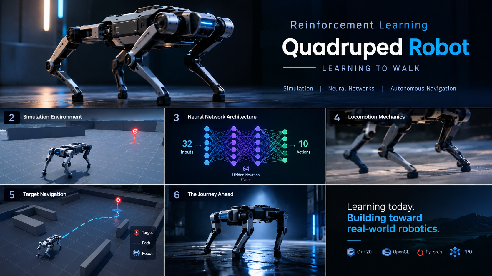

# Quadruped Robot Simulator & Neural Network Controller

<p align="center">
  
</p>

An interactive 3D quadruped robot simulator built in **C++20** and **Modern OpenGL**, featuring realistic contact physics and an integrated **Reinforcement Learning Neural Network** for autonomous navigation and locomotion.

---

## 🌟 Key Features

* **Reinforcement Learning Neural Network Policy**:
  * **Architecture**: 32-dimensional observation space $\to$ 64 hidden neurons (`Tanh`) $\to$ 10 output actions.
  * **Autonomous Navigation**: Perceives target orientation, distance, body velocities, and gait phase to dynamically steer, control speed, and adjust joint angles.
  * **Zero-Dependency Inference**: High-speed header-only C++ forward pass (`PolicyNN`) requiring no external tensor libraries.
* **Realistic Locomotion & Physics**:
  * **Hierarchical RL Framework**: Combines neural decision-making with a Central Pattern Generator (CPG) trotting clock.
  * **Zero-Slip Stance Contacts**: Stance feet anchor to the ground; backward leg sweeps realistically propel the body forward without artificial floating or translation.
  * **Dynamic Body Motion**: Natural body heave, pitch bounce, roll sway, and banking into turns.
* **Dual Control Architectures**:
  * **RL Neural Network Mode** *(Default)*: Target pursuit with neural steering, velocity modulation, and joint angle residuals.
  * **Classical LIPM Stabilizer Mode**: Zero-Moment Point (ZMP) balance with a 6-DOF Quadratic Programming (QP) contact force solver.
* **Minimalist Studio Environment**:
  * Clean gray studio atmosphere with directional lighting.
  * Bounded arena square with grid markers.
  * Interactive target marker with vertical guidance beacon.

---

## 🎮 Interactive Controls

| Input | Action |
| :--- | :--- |
| **Mouse Left Drag** | Orbit camera around robot / focus point |
| **Mouse Right / Middle Drag** | Pan camera |
| **Mouse Scroll** | Zoom camera in / out |
| **`M`** | **Toggle Mode**: Switch between **RL Neural Network** and **Classical Stabilizer** |
| **`T`** | **Toggle Target Mode**: Fixed Waypoint vs. Continuous Autonomous Patrol |
| **`C`** | Toggle Camera Tracking (follow robot vs. free orbit) |
| **`Space`** | Pause / Resume simulation |
| **`R`** | Reset robot to arena origin |
| **`H`** | Toggle On-Screen Information Overlay |
| **`Esc`** | Exit simulator |

---

## 📂 Project Structure

```
robot_nural_network/
├── CMakeLists.txt              # CMake build configuration (GLFW FetchContent)
├── README.md                   # Project documentation
├── .gitignore                  # Git ignore patterns
│
├── src/                        # C++20 Simulation Core & Renderer
│   ├── main.cpp                # Application entry point, event loop, HUD overlay
│   ├── gl.hpp / gl.cpp         # Direct OpenGL 3.3 Core profile loader
│   ├── math.hpp                # Vectors, matrices, quaternions, geometry math
│   │
│   ├── robot/                  # Robot kinematics, dynamics & AI policy
│   │   ├── quadruped.hpp/.cpp  # Quadruped kinematics, stance solver, gait modulation
│   │   ├── policy_nn.hpp       # C++ Neural network forward pass implementation
│   │   ├── policy_weights_default.hpp # Pre-trained network weights
│   │   ├── stabilizer.hpp/.cpp # Classical LIPM & active stabilizer
│   │   └── qp_solver.hpp       # Active-set Quadratic Programming force solver
│   │
│   ├── scene/                  # 3D Scene, lighting, and ground arena
│   │   ├── scene.hpp/.cpp      # Studio world, bounded floor, target beacon
│   │   └── ...
│   │
│   ├── render/                 # Graphics pipeline
│   │   ├── camera.hpp/.cpp     # Smooth orbital camera
│   │   ├── mesh.hpp/.cpp       # Box, sphere, and line primitives
│   │   └── shader.hpp/.cpp     # GLSL shader program management
│   │
│   └── physics/                # Rigid-body dynamics and contacts
│       └── physics.hpp/.cpp    # Physics simulation engine
│
└── training/                   # Reinforcement Learning Pipeline (Python)
    ├── train_rl.py             # PPO Actor-Critic training script & weight exporter
    ├── quadruped_env.py        # Vectorized simulation environment
    └── model_weights.json      # Trained network weights exported from PyTorch

└── vhdl/                       # Hardware Neural Network Accelerator (FPGA/ASIC)
    ├── nn_types_pkg.vhd        # Q4.12 fixed-point types & dimensional constants
    ├── weights_pkg.vhd         # Quantized pre-trained weights (W1, W2) & biases (b1, b2)
    ├── activation_tanh.vhd     # Pipelined symmetric LUT + interpolation Tanh
    ├── neuron.vhd              # Artificial neuron (multiplication, addition & activation)
    ├── hidden_layer.vhd        # 64-neuron hidden layer (32 inputs)
    ├── output_layer.vhd        # 10-neuron output layer (64 inputs)
    ├── policy_network_top.vhd  # Cascaded policy controller accelerator
    ├── uart_rx.vhd             # 8-N-1 UART receiver for input cable
    ├── uart_tx.vhd             # 8-N-1 UART transmitter for output cable
    ├── top.vhd                 # Master FPGA top-level entity with UART interface
    ├── top.ucf                 # User Constraints File (UCF) for FPGA pin mappings
    └── README.md               # Hardware architecture & synthesis documentation
```

---

## 🚀 Building & Running

### Prerequisites
* **CMake 3.20+**
* **C++20 compatible compiler** (MSVC 2019+, GCC 10+, or Clang 11+)
* **Python 3.9+** and **PyTorch** *(only if re-training the neural network)*

### 1. Build the Simulator

```bash
# Configure build directory
cmake -B build -G Ninja -DCMAKE_BUILD_TYPE=Release

# Compile executable
cmake --build build --config Release
```

### 2. Run the Simulator

```bash
./build/robot_sim.exe
```

---

## 🧠 Training the Neural Network (Optional)

The project includes pre-trained weights in [policy_weights_default.hpp](file:///c:/Users/gnich/Desktop/robot_nural_network/src/robot/policy_weights_default.hpp). To train a new policy from scratch:

```bash
cd training

# Install Python requirements
pip install torch numpy gymnasium

# Run PPO training
python train_rl.py
```

The script will automatically train the actor-critic policy, evaluate target tracking performance, and export updated weights into `model_weights.json` and `policy_weights_default.hpp`.
